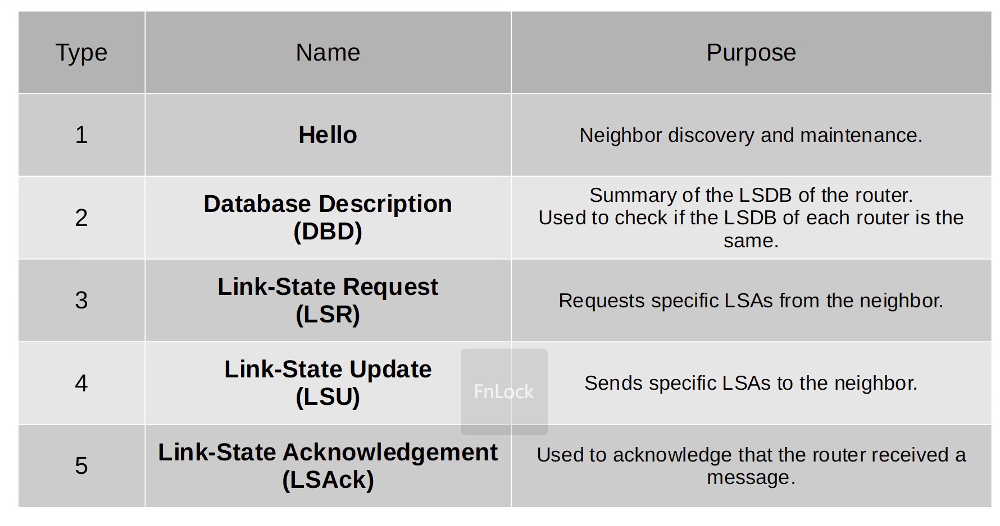
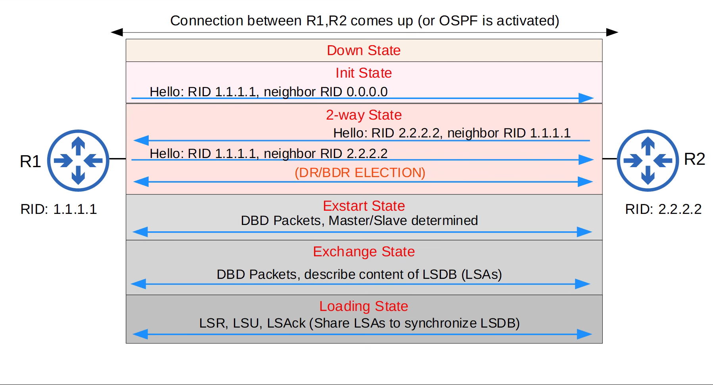

# OSPF

## What is OSPF?

OSPF (Open Shortest Path First) is a link-state Interior Gateway Protocol (IGP) used to exchange routing information between routers within the same autonomous system.

It helps routers discover network paths, calculate the best routes, and update routing information when the topology changes.

OSPF is an open standard and is commonly used in enterprise networks.

## How Does OSPF work in Network?

1.Enable OSPF: Configure OSPF on the relevant router interfaces.

2. Discover neighbors: Routers exchange Hello packets to discover one another.

3. Establish neighbor relationships: Routers check whether they can form the required adjacency.

4. Exchange database information: Routers exchange Database Description (DBD) packets and request missing information.

5. Share topology information: Routers exchange Link-State Advertisements (LSAs) inside Link-State Update (LSU) packets.

6. Synchronize databases: Routers build and synchronize their Link-State Databases (LSDBs).

7. Calculate routes: Each router runs the Shortest Path First (SPF) algorithm to calculate the best paths.

8. Install routes: The selected routes are added to the routing table.

9. React to changes: When the topology changes, OSPF distributes updated information and recalculates affected routes.

## OSPF Router ID and Loopback Interfaces

### What is a Router ID

A Router ID is a 32-bit value used to identify an OSPF router. It is written in IPv4 dotted-decimal format, for example:

1.1.1.1

The Router ID is an identifier; it does not have to be a reachable host address

## What is a loopback interface?

A loopback interface is a logical interface that does not depend on a physical network port remaining operational.

Example Cisco IOS configuration:

```bash
Router(config)# interface loopback0
Router(config-if)# ip address 1.1.1.1 255.255.255.255
```

The loopback address can be used as the OSPF Router ID, provided the Router ID is selected accordingly

## How is the Router ID selected?

On Cisco IOS, if a Router ID is not manually configured, OSPF generally selects:

The highest IP address on an eligible loopback interface.

If no eligible loopback exists, the highest IP address on an eligible active physical interface.

##  How Does OSPF Work?

1. Routers have IP connectivity on their shared links.

2. OSPF sends Hello packets on enabled interfaces.

3. Routers discover neighbors and check OSPF parameters.

4. Neighbor states progress as the routers establish the appropriate relationships.

5. Routers exchange database summaries and request missing link-state information.

6. LSAs are exchanged and the LSDBs become synchronized where required.

7. Each router independently runs SPF to calculate the best paths.

8. OSPF routes are installed in the routing table if they are selected.

9. Topology changes trigger updates and, when necessary, new calculations.

### OSPF Packet Types



## OSPF Neighbor States

OSPF uses neighbor states to track the progress of establishing relationships and synchronizing databases

