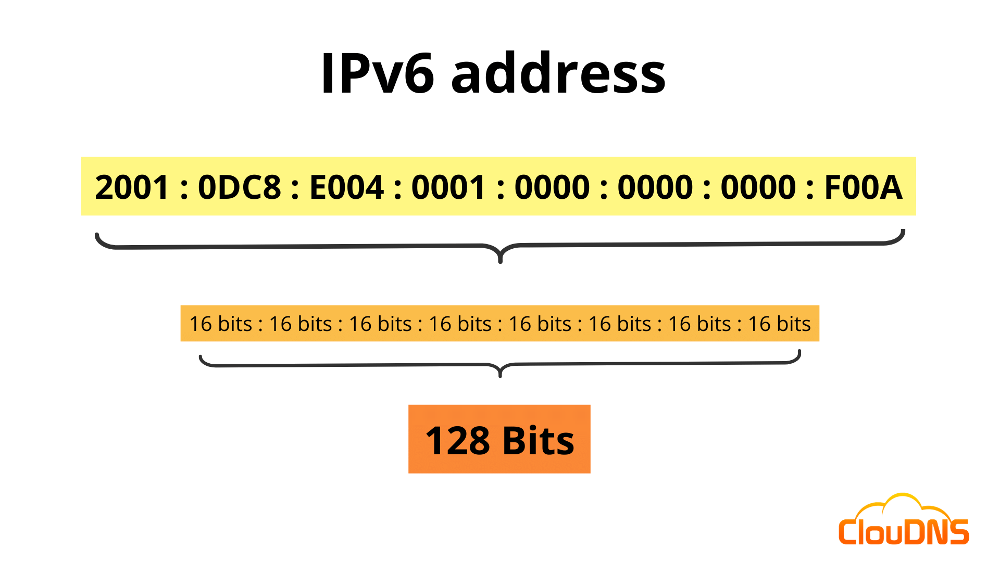

## Why IPv6?
IPv6 (Internet Protocol version 6) was introduced primarily because the internet was running out of available IPv4 addresses.

The problem with IPv4
IPv4 uses a 32-bit address, which provides approximately 2^{32} unique addresses.

2^{32}=4,294,967,296

That is approximately 4.3 billion addresses.

With billions of smartphones, laptops, servers, IoT devices, and other internet-connected equipment, the available IPv4 address pool became insufficient.

## IPv6 Introduction
An IPv6 address is a 128-bit logical address assigned to a network interface

It is written in hexadecimal, divided into eight groups of 16 bits each.

Example:

#### Structure of an IPv6 address

Each group contains 16 bits, or 4 hexadecimal digits.

8 \times 16 = 128\text{ bits}

The colon (:) separates the eight groups, called hextets.

The prefix and interface identifier often divide an IPv6 address into network-related and interface-related portions. However, the exact division depends on the address prefix length; it is not always a fixed 64/64 split.

## IPv6 Address Abbreviation
IPv6 addresses can contain many zeros, so the protocol allows two main abbreviation rules.

#### Rule 1: Remove leading zeros
You can remove zeros from the beginning of each individual hextet

Example:

2001:0DB8:000A:0040:0000:0000:0000:0001

Becomes:

2001:DB8:A:40:0:0:0:1

Notice that you cannot remove trailing zeros.
- 0040 becomes 40.
- 00A0 becomes A0, not A.

#### Rule 2: Replace consecutive zero groups with ::
You can replace one consecutive sequence of all-zero hextets with a double colon.

Example:

2001:DB8:0:0:0:0:0:1

Becomes:

2001:DB8::1

The :: replaces five consecutive zero groups.

Important rule: Use :: only once in an IPv6 address. If you use it twice, the receiver cannot determine how many zero groups belong at each location.

## Identifying the IPv6 Prefix
The prefix identifies the network portion of an IPv6 address.

It is written using slash notation, such as /64, /48, or /128.

Consider:

2001:DB8:1234:5678:ABCD:EF01:2345:6789/64

Here:
- The IPv6 address is 2001:DB8:1234:5678:ABCD:EF01:2345:6789.
- /64 means the first 64 bits belong to the prefix.
- The remaining 64 bits form the interface identifier in this example.

## EUI-64

EUI-64 stands for Extended Unique Identifier, 64-bit.

In IPv6, Modified EUI-64 is a method that can generate a 64-bit interface identifier from a 48-bit MAC address.

Suppose a network interface has this MAC address:

00:1A:2B:3C:4D:5E

How Modified EUI-64 works
1. Split the MAC address into two halves.
   
   00:1A:2B and 3C:4D:5E
2. Insert FF:FE between the halves.
   
   00:1A:2B:FF:FE:3C:4D:5E

3. Invert the U/L bit in the first byte.
   
   The first byte changes from 00 to 02.

4. Use the resulting 64-bit identifier.
   
   021A:2BFF:FE3C:4D5E

The resulting identifier can be combined with a suitable IPv6 prefix to form an IPv6 address.

## IPv6 Address Types
IPv6 supports multiple address types because devices need to communicate within a local network, across networks, with selected groups of devices, and with the nearest member of a service group.

### Global Unicast Addresses (GUA)
A Global Unicast Address is an IPv6 address intended for globally routable communication.
- General global-unicast allocation range: 2000::/3.
- Typical prefix: /64 on an individual LAN.
- Used for servers, cloud resources, and internet-connected devices.

Example:

2001:4860:4860::8888

This is an example of a globally routable IPv6 address used by Google's public DNS service.

Cybersecurity note: A globally routable address does not mean a device is automatically reachable from the internet. Firewalls, routing, and security policies still control access.

### Unique Local Addresses (ULA)
Unique Local Addresses are used within private networks and are not intended to be routed across the public internet.
- Prefix range: FC00::/7
- Commonly generated prefix: FD00::/8
- Roughly comparable in purpose to private IPv4 addresses such as 10.0.0.0/8.
Example:

FD12:3456:789A:1::10

A company could use ULAs to communicate between internal servers, printers, and workstations.

### Link Local Addresses
A Link Local Address is used for communication on the same local network link.
- Prefix: FE80::/10
- Commonly used for Neighbor Discovery Protocol (NDP).
- Used in router discovery and other local-link operations.
- Routers do not forward link-local packets to other links.
Example:

FE80::A12B:34FF:FE56:7890

A computer can use a link-local address to communicate with another device on the same Ethernet or Wi-Fi link, even when it does not have a globally routable IPv6 address.

One important point: a link-local address may need a zone identifier when a computer has multiple network interfaces. For example, an operating system might display an address like fe80::1%12.

## Multicast Addresses
IPv6 multicast allows one sender to transmit a packet to a group of interested receivers.

IPv6 does not use broadcast addresses. Multicast is used for many tasks that might otherwise require broadcast-style communication.
- Multicast prefix: FF00::/8
- Devices join multicast groups when they need to receive packets sent to those groups.
- Routers and switches handle multicast according to protocol and configuration.

Why does IPv6 use multicast instead of broadcast?

Broadcast sends traffic to every device in the broadcast domain, regardless of whether each device needs the information. Multicast allows traffic to target a particular group.

## Multicast Address Scopes
The scope indicates how far a multicast packet is intended to reach.

IPv6 multicast addresses use a scope field within the address.

Common scopes include:
Scope	                Value	    Meaning
Interface-local	          1	        Restricted to a single interface
Link-local	              2	        Restricted to the local link
Realm-local	              3	        Limited to a locally defined realm
Admin-local	              4	        Limited to an administratively defined region
Site-local	              5	        Limited to a site
Organization-local	      8	        Limited to an organization
Global	                  E	        Global scope

These scopes describe intended reach, but actual forwarding also depends on network configuration and multicast routing.

These scopes describe intended reach, but actual forwarding also depends on network configuration and multicast routing.

For example:
- FF01::1 — all nodes on the local interface.
- FF02::1 — all nodes on the local link.
- FF02::2 — all routers on the local link.
Important distinction: FF02::1 is not an address for all nodes on the internet. The 2 in the scope field indicates link-local scope.

## Anycast Addresses
Anycast is an addressing method where the same IPv6 address is assigned to multiple interfaces.

When a sender transmits a packet to an anycast address, routing delivers it to one member of the group, usually the nearest according to the routing protocol's path selection.

Imagine a company has three DNS servers located in different cities. They can advertise the same service address from different locations.