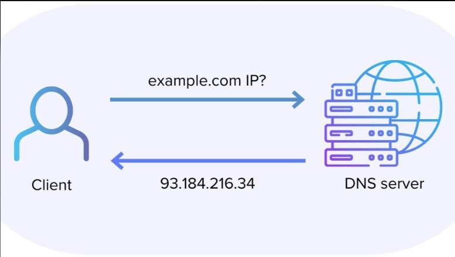
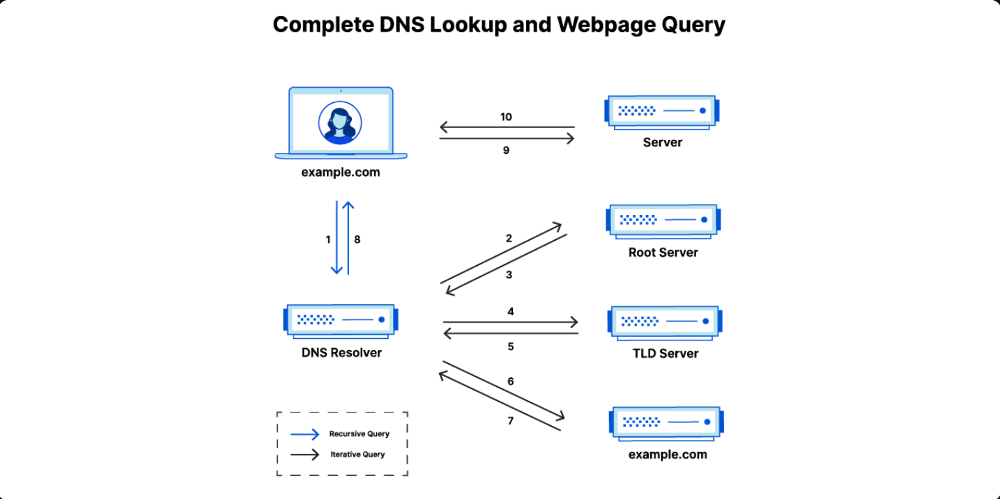

## DNS
#### DNS is the phonebook of the Internet. It translates human-readable domain names to machine-readable IP addresses.

### What is DNS?
DNS Stands for Domain Name System.

It is a naming system that translates human-redable domain name into IP addresses that computers use to comminicate over a network. 

For example, when you enter:

www.google.com

computer needs to find the IP address associated with that domain name.

### How does DNS work?

#### There are 4 DNS servers involved in loading a webpage:
- DNS recursor : The DNS recursor is a server designed to receive queries from client machines through applications such as web browsers. Typically the recursor is then responsible for making additional requests in order to satisfy the client’s DNS query.
- Root nameserver - The root server is the first step in translating (resolving) human readable host names into IP addresses. It can be thought of like an index in a library that points to different racks of books - typically it serves as a reference to other more specific locations.
- TLD nameserver - The top level domain server (TLD) can be thought of as a specific rack of books in a library. This nameserver is the next step in the search for a specific IP address, and it hosts the last portion of a hostname (In example.com, the TLD server is “com”).
- Authoritative nameserver - This final nameserver can be thought of as a dictionary on a rack of books, in which a specific name can be translated into its definition. The authoritative nameserver is the last stop in the nameserver query. If the authoritative name server has access to the requested record, it will return the IP address for the requested hostname back to the DNS Recursor (the librarian) that made the initial request.

### The 8 steps in a DNS lookup:
1. A user types google.com’ into a web browser and the query travels into the Internet and is received by a DNS recursive resolver.
2. The resolver then queries a DNS root nameserver (.).
3. The root server then responds to the resolver with the address of a Top Level Domain (TLD) DNS server (such as .com or .net), which stores the information for its domains. When searching for google.com, our request is pointed toward the .com TLD.
4. The resolver then makes a request to the .com TLD.
5. The TLD server then responds with the IP address of the domain’s nameserver, google.com.
6. Lastly, the recursive resolver sends a query to the domain’s nameserver.
7. The IP address for google.com is then returned to the resolver from the nameserver.
8. The DNS resolver then responds to the web browser with the IP address of the domain requested initially.

Once the 8 steps of the DNS lookup have returned the IP address for ggole.com, the browser is able to make the request for the web page:

9. The browser makes a HTTP request to the IP address
10. The server at that IP returns the webpage to be rendered in the browser (step 10).

