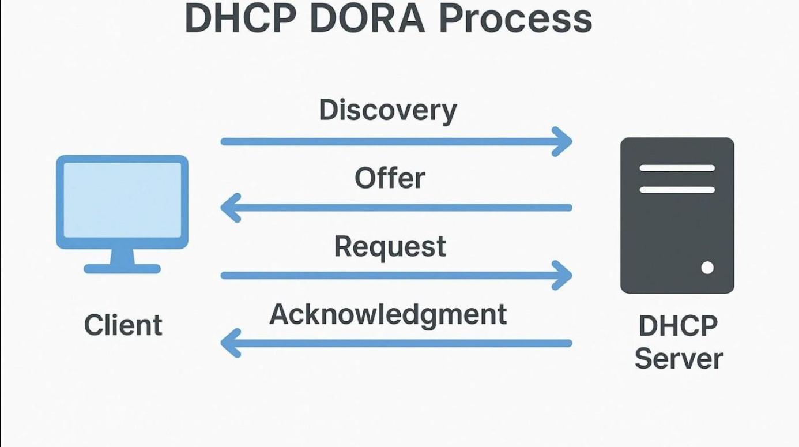
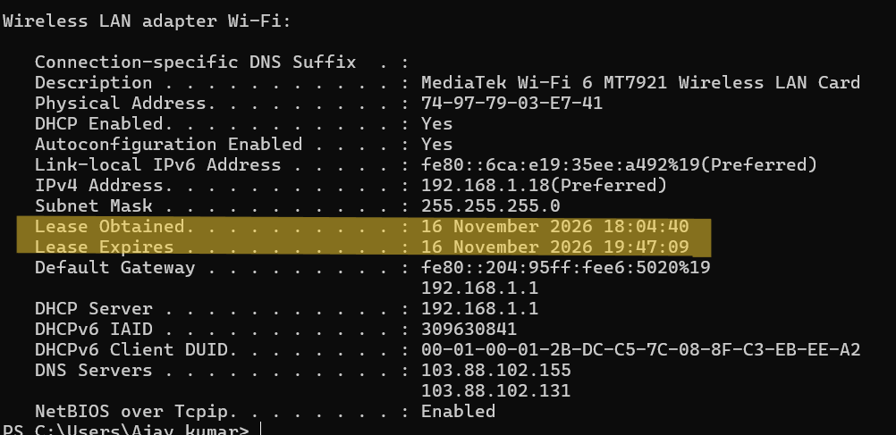
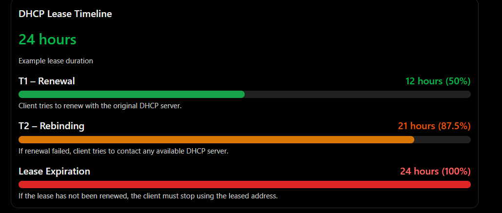

## DHCP(Dynamic Host Configuration Protocol)

### What is DHCP?
Dynamic Host Configuration Protocol is used to assign the IP addresses and other network configuration to the newly added devices into the network.

Imagine you connect your laptop to your home Wi-Fi.

Your laptop needs some network information to communicate with other devices and access the internet.

For example:
- IP address
- Subnet mask
- Default gateway
- DNS server address

### How does DHCP work?
#### DORA(Discover, Offer, Request, Acknowledge)



**Discover** : Whenever a new device connect to the network ,it sends a broadcast message to DISCOVER the DHCP server.

**Offer** : The DHCP server will receive the Discover message and resopnd to OFFER a IP address to the connected device.

**Request** : The device receives the offfer and it sends a DHCP REQUEST message indicating that i want to use the offered IP address.

**Acknowledge** : The DHCP server will ACKNOWLEDGE indicating your IP address is confirmed.

After the DORA process the connected device will get IP address, Subnetmask, Default gateway, DNS server address and Lease time.

### DHCP Communication
The communication basically happen using UDP(User Datagram Protocol)
```
Port	    Purpose
UDP 67	    DHCP Server
UDP 68	    DHCP Client
``` 
Remember:
- DHCP Client listens on UDP port 68.
- DHCP Server listens on UDP port 67.

### What is Lease Time?
- When the DHCP server assign the IP address to the connected device it will also set random amount lease time it will not necessarily assign it permanentaly
- After the lease timeout the device asks for renewal this time insted of DORA Process again. 



### Lease Renewal
DHCP Renewal is the process by which a DHCP client requests permission to continue using its currently assigned IP address before its DHCP lease expires.

#### How does DHCP Renewal work?
DHCP uses two important timers:
- T1 – Renewal Timer: 50% of the lease duration.
- T2 – Rebinding Timer: 87.5% of the lease duration.



### T1 – DHCP Renewal (50%)
After 12 hours, the device reaches the T1 renewal timer.

It sends a DHCP Request message to the original DHCP server that assigned its IP address.

#### DHCP ACK

The server confirms the lease renewal and provides the updated lease duration.

If the server doesn't respond, the client continues using its existing IP address while waiting for T2.

### T2 – DHCP Rebinding (87.5%)
Suppose the device tries to renew its IP address at T1, but the original DHCP server is unavailable.

The device continues using its current IP address until it reaches T2.

At 21 hours, the rebinding process begins.

Now the client sends a DHCP Request as a broadcast message.

If a server responds with DHCP ACK, the lease is renewed.

#### What happens if DHCP Renewal fails?
Suppose:
- Lease duration = 24 hours
- T1 = 12 hours
- T2 = 21 hours
The device attempts renewal at T1 and rebinding at T2.

But neither attempt succeeds.

At 24 hours, the DHCP lease expires.

The device must stop using the expired IP address and obtain a valid address through DHCP before normal IP communication can continue.

##### The process starts from the DORA again!!!