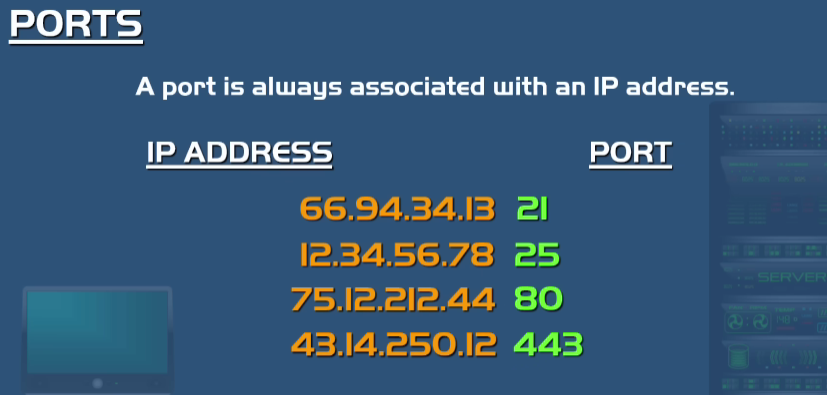
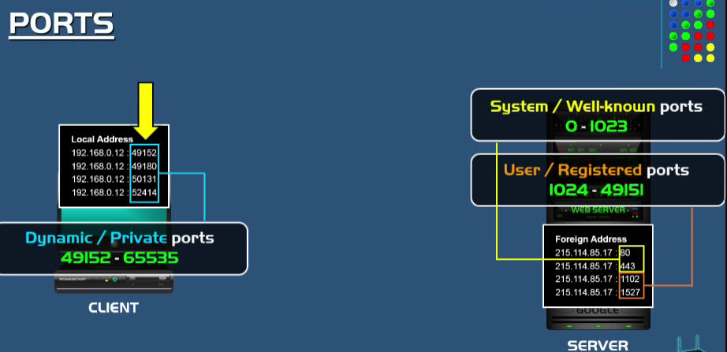

### #PORTS

### What is Port?
- A port is Not a physical connection.
- It's a logical connection that's used by programs and services to exchange information. 
- It specifically determines which program or service on a computer or server that is going to be used.
- Ports will have a unique number that identifies them.
```
0 - 65535

common port numbers.
80,433 - web pages(HTTP, HTTPS)
    21 - FTP(File Transfer protocol)
    25 - Email(SMPT)
```


If you want to connect to a server over the internet the IP address is used to determine the geographical location that server, such as what continent, country and city so on, and the port number determines which service or program on that server it want to use, whether that server program's web page, FTP, Email so on.

Example : When you want to access the google webpage then we open web browser, we type google.com in the browser then it convert the Domain name into ip addres, so when we are rquesting for the web page we use the http protocol then it will add port 80 as a port number along with the domain ip address. Once the server is found the ip address has done it's job, now it's port number tern, the google web server will see the incoming request with port number 80 and it forward the request to it's built in web pserver then we finally retrieve google web page.

Port numbers range from 0-65535

They are assigned by IANA(Internet assigned Numbers Authority).

#### Port numbers are broken down into 3 categories.

- Port numbers 0-1023 are called System or Well-known ports. 
Example: 80, 443, 25, 21

- Port numbers from 1024-49151 are called User or Registered ports.
Example:
- 1102 - Adobe Server
- 1433 - Microsoft SQL Server
- 1415 - Novell
- 1527 - Oracle

- Port numbers 49152 - 65535 are called Dynamic or Prvate ports
These are client-side ports that are free to use. These are ports that your computer assigns temporarily to itself during a session.


