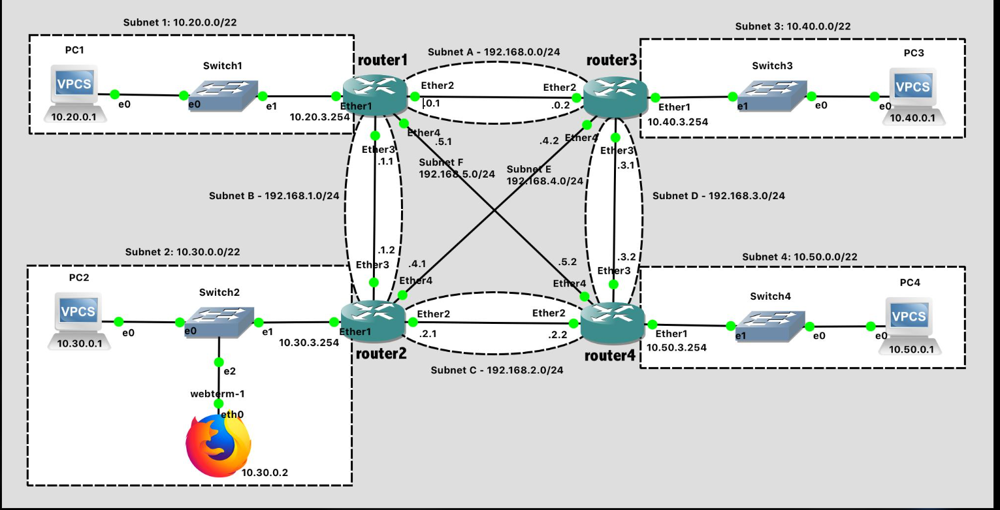
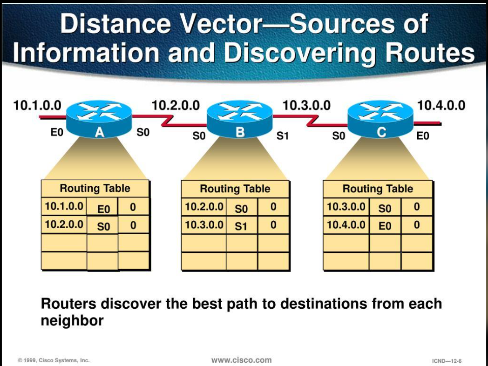
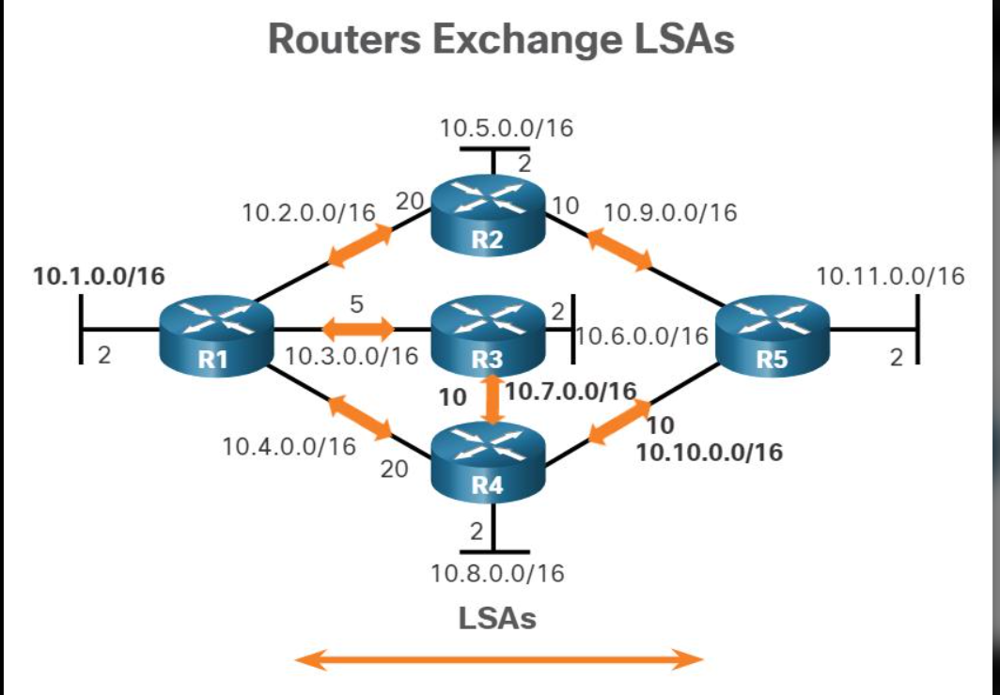

# Dynamic Routing
- Dynamic routing is a process in which routers automatically learn network routes, exchange routing information with other routers, and update their routing tables when network conditions change
- Instead of an administrator manually configuring every route, routers use routing protocols to discover and select paths to destination networks.

Suppose Router A needs to send data to a network connected to Router C.
- Router A learns about available routes through a routing protocol.
- It selects a suitable path to reach Router C's network.
- If the selected path fails, the routers can exchange updated routing information and choose an alternative path, if one is available.

This ability to adapt to network changes is the main advantage of dynamic routing.

## How does dynamic routing work?
### Step 1: Discover neighboring routers
Routers running a compatible routing protocol discover or establish relationships with neighboring routers.

### Step 2: Exchange routing information
Routers share information about destination networks and routes, according to the protocol they use.

### Step 3: Select the best route
The router uses the protocol's route-selection rules to choose a preferred path to each destination.

### Step 4: Update routes when conditions change
If a route fails or a better route becomes available, the router can recalculate and update its routing table.

## Dynamic routing protocols
Routers use routing protocols to learn routes and determine how to reach destination networks.

### RIP — Routing Information Protocol
Uses hop count as its routing metric. A route can have at most 15 hops to be considered reachable; 16 means unreachable.

### OSPF — Open Shortest Path First
A link-state protocol that builds a view of network topology and uses the Shortest Path First algorithm to calculate routes.

### BGP — Border Gateway Protocol
Exchanges routing information between autonomous systems and uses routing policies and path attributes to select routes.

### EIGRP — Enhanced Interior Gateway Routing Protocol
Uses a composite metric and the DUAL algorithm to calculate loop-free routes and support fast convergence.

## What is a routing metric?
- A routing metric is a value or set of attributes used to evaluate routes.

Consider two possible paths to the same destination:

### What happens when a link fails?
Suppose Router A reaches a destination through Router B. If that link goes down, the routing protocol detects the change and updates its route information.

The process of adapting to network changes is called convergence.

Convergence is not necessarily instantaneous. It depends on the protocol, network configuration, failure-detection mechanisms and topology.

This matters in cybersecurity because routing changes can also be malicious or misconfigured. For example, a false route advertisement can redirect traffic, while BGP route leaks can send traffic along unintended paths.

*** 1. Distance Vector Protocols***
*** 2. Link-State Protocols***

## 1. Distance Vector Protocol
A distance-vector routing protocol allows a router to learn about available networks from its neighboring routers. It uses routing information such as the destination network and the distance or cost to reach that network.

- Distance means the cost of reaching a destination.
- Vector refers to the direction or next-hop router through which the destination can be reached.

## How it works
1. Each router identifies the networks it knows about.
2. It shares routing information with its neighbors.
3. Neighboring routers update their routing tables based on the received information.
4. Routers select the best available route according to the protocol's metric.
5. Updates allow routers to respond to network changes, although convergence can take time.

#### Example
Suppose Router A needs to reach Network X through Router B.
- Router A learns from Router B that Network X is two hops away.
- Router A adds the cost of reaching Router B to that distance.
- It records the resulting route and next hop in its routing table.
- If another route has a lower metric, Router A can choose that route instead.

## Examples
- **RIP**: Uses hop count; 15 hops is the maximum reachable distance.
- **EIGRP**: Uses the DUAL algorithm and a composite metric; it is an advanced distance-vector protocol.

## 2 Link-State Protocol
A link-state routing protocol allows routers to build a representation of the network topology and calculate the best paths using that information.

Instead of relying only on routes learned from neighbors, each router learns about network links and their states, builds a topology database, and runs a shortest-path algorithm.

**How it works**
1. Discover neighbors: Routers identify directly connected neighboring routers.
2. Share link-state information: Routers distribute information about their links using link-state advertisements.
3. Build a topology database: Each router collects the information needed to create a network topology view.
4. Calculate the shortest path: The router runs Dijkstra's Shortest Path First (SPF) algorithm.
5. Update the routing table: The router installs the selected best routes.
6. React to changes: When a link fails or the topology changes, updated information triggers recalculation.

Example
Imagine Router A can reach Network X through either Router B or Router C.
- Path A → B → X has a total cost of 20.
- Path A → C → X has a total cost of 10.

If these costs are the metrics used by the protocol, Router A selects the path through Router C.

The important point is that the router calculates a path using its topology information and the link costs, rather than simply adding a neighbor's advertised distance as in a traditional distance-vector protocol.

Examples
- **OSPF**: Uses link-state information and the SPF algorithm. It supports areas to organize larger networks.
- **IS-IS**: Uses link-state information and shortest-path calculations, commonly in larger enterprise and service-provider networks.